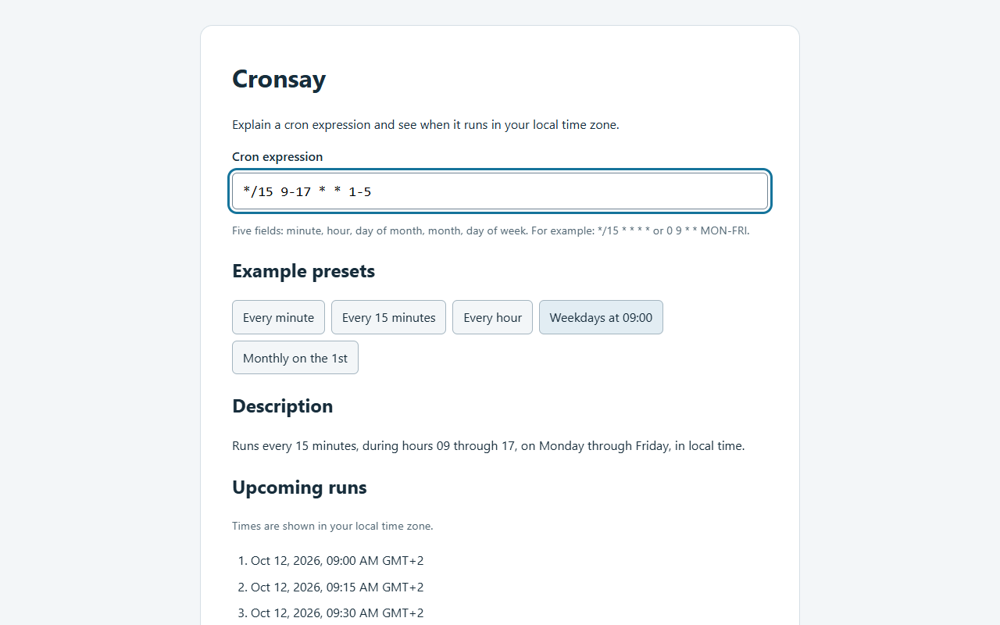
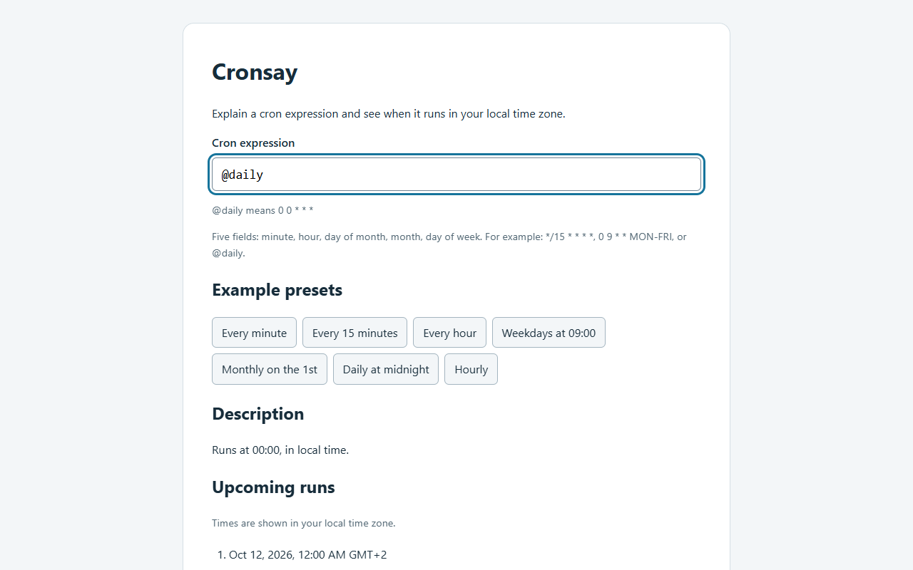

<p align="center"></p>

# cronsay

A small web app that explains a five-field cron expression in plain English and lists its next 10 runs in your local time zone, for developers and operators who want to check a schedule before using it.

[](https://github.com/Gulliby-development/cronsay/actions/workflows/ci.yml) [](LICENSE)



## Why

You have a crontab line or a CI schedule and want to be sure it fires when you think it does. Type the expression and read the description and the concrete upcoming run times, with validation errors shown inline. The cron parser is written in TypeScript with no cron library, and nothing is executed: cronsay only explains schedules.

## Install

Install [Bun](https://bun.sh/), clone this repository, then in the project directory run:

```text
bun install
bun run dev
```

Open the local URL printed by Vite (by default http://localhost:5173/). The same commands work on Windows, macOS and Linux.

## Usage

Type an expression in the input, or click a preset to fill it. A valid expression shows a description and the next 10 run times with a time zone name or offset. An invalid expression shows an inline error instead of stale results.

The field order is `minute hour day-of-month month day-of-week`:

| Expression | Schedule |
| --- | --- |
| `*/15 * * * *` | Every 15 minutes. |
| `0 9 * * 1-5` | Monday through Friday at 09:00 local time. |
| `0 0 1 * *` | At midnight on the first day of each month. |
| `@daily` | Runs at 00:00, in local time. |
| `*/15 9-17 * * 1-5` | "Runs every 15 minutes, during hours 09 through 17, on Monday through Friday, in local time." |

### Supported syntax

| Form | Meaning |
| --- | --- |
| `*` | Every value of the field |
| `5`, `1,15,30` | A value, or a list of values |
| `9-17` | A range |
| `*/15`, `10-30/5`, `5/10` | Positive steps; `5/10` runs from 5 through the field maximum in steps of 10 |
| `JAN`-`DEC`, `SUN`-`SAT` | Month and weekday names, case-insensitive |
| `0` or `7` | Sunday |
| `@yearly`, `@annually`, `@monthly`, `@weekly`, `@daily`, `@midnight`, `@hourly` | Standard schedule macros |

The macros expand as follows: `@yearly` and `@annually` → `0 0 1 1 *`; `@monthly` → `0 0 1 * *`; `@weekly` → `0 0 * * 0`; `@daily` and `@midnight` → `0 0 * * *`; `@hourly` → `0 * * * *`.



Six- and seven-field expressions, `@reboot` and other macros, and the special tokens `?`, `L`, `W` and `#` are not supported. When both day-of-month and day-of-week are restricted, either may match (Vixie cron semantics).

Run times are strictly after the current time and use your browser's time zone. Nonexistent times in daylight-saving gaps are skipped. The search is bounded to about eight years, so a valid schedule that never matches, such as `0 0 31 2 *`, shows a no-upcoming-runs message. Check the time zone and cron dialect of your real scheduler before relying on a schedule.

## Development

```text
bun install
bun test
bun run typecheck
bun run lint
bun run build
```

Tests use `bun:test` for the parser, next-run calculator, descriptions, presets and UI interactions. `bun run build` writes the production site to `dist/`, and `bun run preview` serves that build locally. The package scripts contain no platform-specific shell syntax.

## License

MIT, see [LICENSE](LICENSE).

---

Built with BAKED, an open-source coding agent (bench loop round 02, BAKED ac45a9c).
